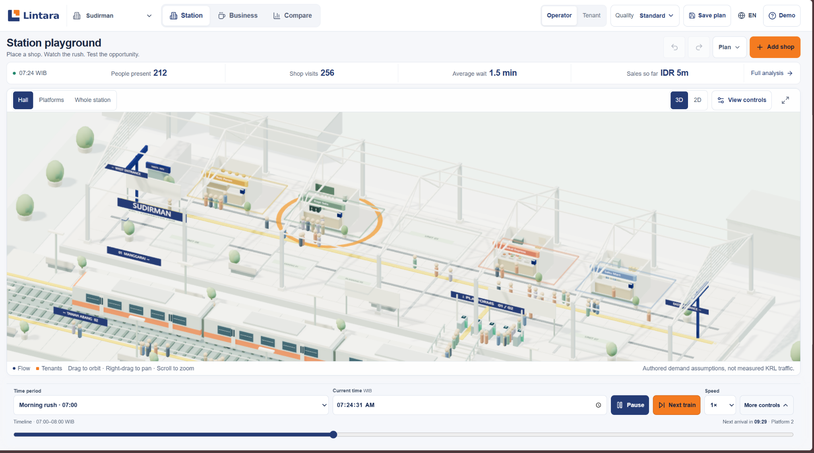
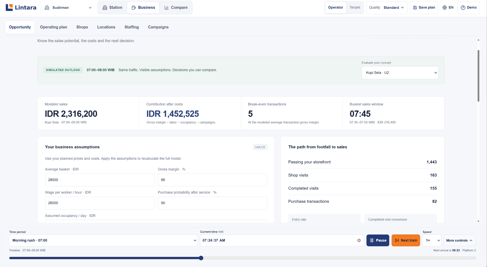
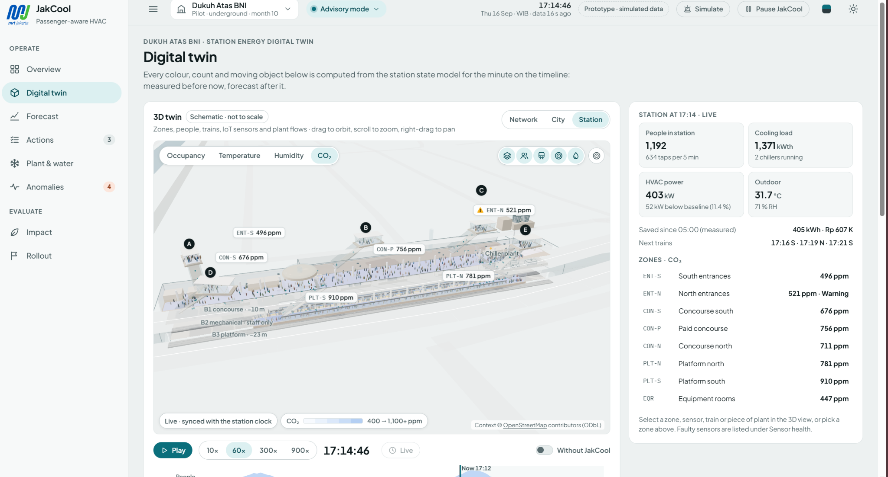
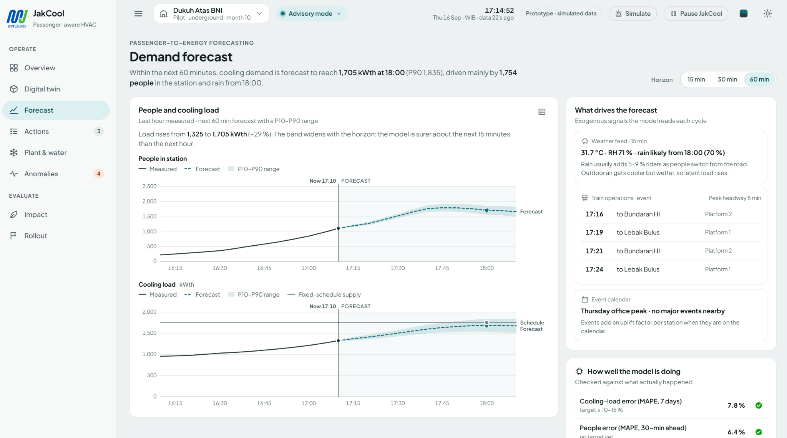
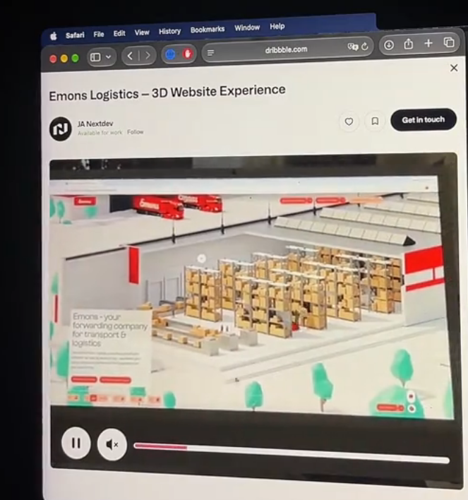
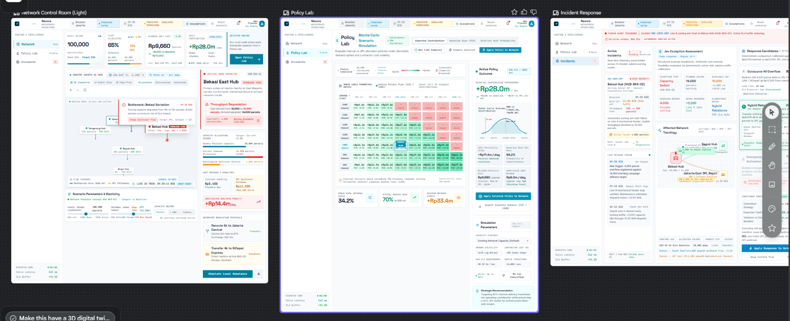
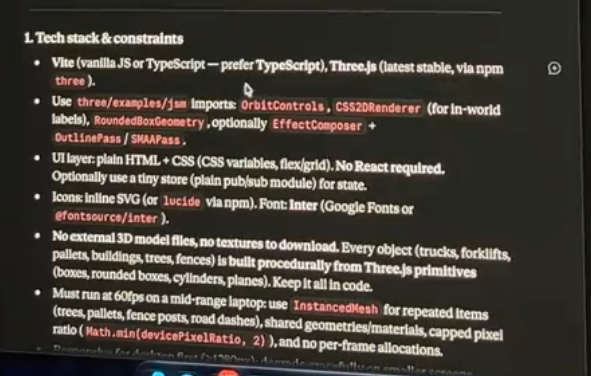
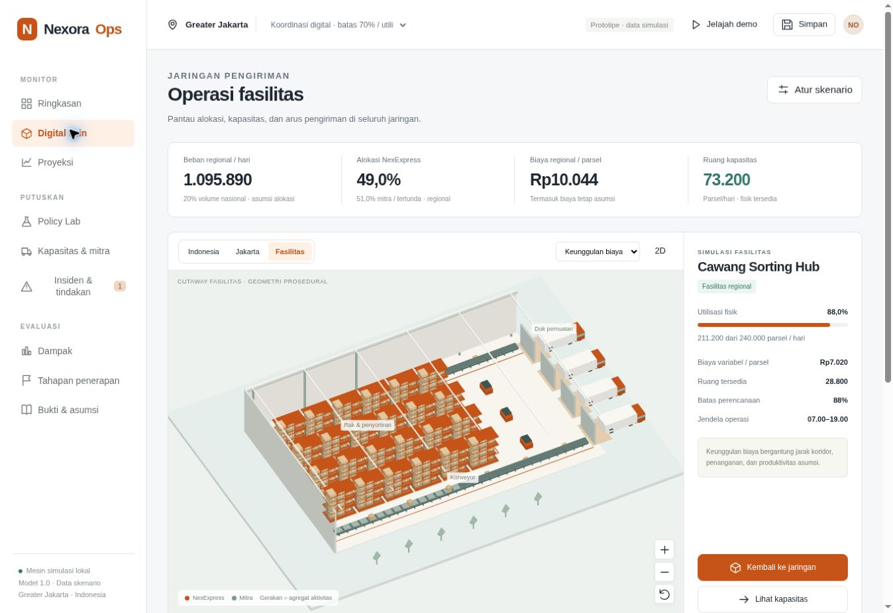

# Visual reference guide

The supplied images are reference material for composition and interaction. NexoraOps adapts their useful patterns without reproducing their product branding or claiming their data as Nexora evidence.

## Lintara: immersive twin

Apply the large central scene, slim metrics strip, camera controls and replay timeline. The facility view uses the same focus on understandable miniature activity, adapted from a station to a logistics warehouse.

Apply the readable financial outcomes, quiet form controls and clear relationship between assumptions and results. NexoraOps uses project cash flows and group profit rather than shop sales.

## JakCool: shell and charts

Apply grouped sidebar navigation, spacious page heading, large twin and contextual inspector. Secondary detail follows selection rather than competing with the primary visual.

Apply large paired time-series charts and a supporting driver panel. NexoraOps uses normalized planning profiles and labels the scenario range without claiming measured prediction accuracy.

## Warehouse cutaway

Apply the open roof, warehouse scale, steel racks, pallets, conveyors, loading vehicles, small moving objects and soft isometric presentation. The NexoraOps facility is authored procedural geometry, not a downloaded model or a measured site reconstruction.

## Earlier Nexora screens

Preserve the conceptual connections between control room, policy evaluation and incidents. The current interface distributes these responsibilities across nine screens and gives the main scene or chart more room.

The four supplied Stitch screens are preserved under `references/stitch/`. Their layout and palette are useful references. Their illustrative financial values do not override the completed analysis.

## Constraints and document template

The user explicitly relaxed the first stack bullet and later treated the screenshot as guidance. The current implementation uses dependency-free native browser rendering, while retaining procedural assets, small aggregated actors, camera control, reduced decorative quality and no external model downloads.

The competition essay-template image is archived as `competition-essay-template.png`. It informs possible written-essay structure, not the website layout. No Idea Champion theme is assumed to replace the IBSC Nexora case.

## Finished facility example

Captured from the running website with the Canvas projection fallback. The inspector shows calculated variable route cost and selected-hub utilization.
